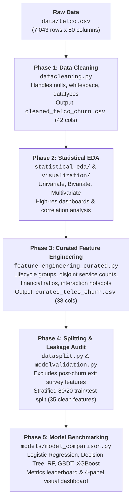

# Customer Churn Prediction & Retention Analytics

An end-to-end, production-grade Machine Learning pipeline built on the **IBM Telco Customer Churn dataset** (7,043 customers). This project encompasses automated data cleaning, statistical exploratory data analysis (EDA), non-redundant feature curation, target leakage prevention, and multi-model benchmarking across linear, tree, and ensemble architectures.

---

## Table of Contents

- [Project Overview](#project-overview)
- [End-to-End Architecture](#end-to-end-architecture)
- [Phase-by-Phase Technical Milestones](#phase-by-phase-technical-milestones)
  - [Phase 1: Data Cleaning & Hygiene](#phase-1-data-cleaning--hygiene)
  - [Phase 2: Statistical EDA & Key Business Insights](#phase-2-statistical-eda--key-business-insights)
  - [Phase 3: Curated Feature Engineering](#phase-3-curated-feature-engineering)
  - [Phase 4: Data Splitting & Target Leakage Forensic Audit](#phase-4-data-splitting--target-leakage-forensic-audit)
  - [Phase 5: Model Development & Evaluation](#phase-5-model-development--evaluation)
- [Model Performance Leaderboard](#model-performance-leaderboard)
- [Business Recommendations](#business-recommendations)
- [Repository Structure](#repository-structure)
- [Quickstart & Execution Guide](#quickstart--execution-guide)

---

## Project Overview

- **Business Objective**: Predict customer churn risk ahead of time to allow proactive retention interventions, optimize marketing spend, and maximize Customer Lifetime Value (CLTV).
- **Dataset**: IBM Telco Customer Churn (7,043 customers, 50 raw attributes, 26.54% overall churn rate).
- **Core ML Target**: `Churn Label` (`Yes: 1`, `No: 0`).
- **Champion Model**: **XGBoost Classifier** achieving **85.59% Accuracy**, **71.12% F1-Score**, and **0.9142 ROC-AUC** on legitimate, leakage-free pre-churn signals.

---

## End-to-End Architecture



---

## Phase-by-Phase Technical Milestones

### Phase 1: Data Cleaning & Hygiene
- **Script**: [`datacleaning.py`](file:///Users/apple/projects/Datascience/churndataset/datacleaning.py)
- **Input**: 7,043 rows $\times$ 50 columns $\to$ **Output**: 7,043 rows $\times$ 42 columns.
- **Operations**:
  - Resolved whitespace blank strings in `Total Charges` and converted to numeric float.
  - Imputed missing values for service subcomponents based on account type.
  - Standardized categorical text labels and verified boolean mappings.
  - Dropped post-churn outcome columns present in raw data (`Customer Status`, `Churn Category`, `Churn Reason`, `Churn Score`) to prevent trivial leakage.

---

### Phase 2: Statistical EDA & Key Business Insights
- **Directories**: [`statistical_eda/`](file:///Users/apple/projects/Datascience/churndataset/statistical_eda) and [`visualization/`](file:///Users/apple/projects/Datascience/churndataset/visualization)
- **Visual Dashboards**: 18 high-resolution 300-DPI charts in `plots/`.
- **Key EDA Findings**:
  1. **Contract Type is the #1 Churn Driver**: Month-to-month contracts exhibit a **42.7% churn rate**, compared to **11.3%** for 1-year and **2.8%** for 2-year contracts.
  2. **Ecosystem Switching Moat**: Customers adopting technical protection services (Online Security, Backup, Tech Support) have churn rates below **15%**, whereas customers with 0 support tools churn at **45.6%**.
  3. **Tenure Fragility**: Over **53%** of all churn occurs within the first 6 months of onboarding.
  4. **The Fiber Optic Paradox**: Fiber Optic subscribers churn at **40.7%** (vs. **18.9%** for DSL), driven by high monthly charges combined with zero technical support tools.

---

### Phase 3: Curated Feature Engineering
- **Script**: [`feature_engineering_curated.py`](file:///Users/apple/projects/Datascience/churndataset/feature_engineering_curated.py)
- **Input**: `data/cleaned_telco_churn.csv` $\to$ **Output**: `data/curated_telco_churn.csv` (7,043 rows $\times$ 38 columns).
- **Engineered Predictors (Zero Redundancy)**:
  - **Tenure Lifecycle**: `Tenure_Group` (`Onboarding`, `First-Year`, `Developing`, `Established`, `Loyal`).
  - **Disjoint Service Counts**: `Support_Service_Count` (0–4 tech tools) and `Streaming_Service_Count` (0–3 entertainment tools) partitioned orthogonally to eliminate multicollinearity.
  - **Financial Ratios**:
    - `Bill_Hike_Ratio`: Current monthly bill vs. historical monthly average (detects promo expirations).
    - `Extra_Charge_Ratio`: Proportion of total bill stemming from penalty/overage data charges.
    - `Cost_Per_GB`: Bandwidth price efficiency metric.
    - `Is_High_ARPU`: High revenue account indicator ($\ge \$75/\text{month}$).
  - **Interaction Hotspots**:
    - `Is_Fiber_MonthToMonth`: Identifies the primary churn epicenter (Month-to-month + Fiber Optic: 58.8% churn).
    - `Is_Zero_Support_Fiber`: Identifies high-friction fiber customers with zero security/support tools.
    - `High_Risk_Billing`: Paperless billing combined with electronic bank withdrawal.
    - `Is_Toxic_Offer_E`: Flags promotional acquisition channel with 52.9% churn.
  - **Pruned Noise (16 Columns)**: Dropped zero-variance demographic fields (`Gender`, `Under 30`), commoditized phone lines, collinear sub-billing totals, and high-cardinality geographical attributes (`City`, `Zip Code`, `Latitude`, `Longitude`, `Population`, `CLTV`).

---

### Phase 4: Data Splitting & Target Leakage Forensic Audit
- **Scripts**: [`datasplit.py`](file:///Users/apple/projects/Datascience/churndataset/datasplit.py), [`finaldataset.py`](file:///Users/apple/projects/Datascience/churndataset/finaldataset.py), [`modelvalidation.py`](file:///Users/apple/projects/Datascience/churndataset/modelvalidation.py)
- **Target Leakage Discovery**:
  - Investigation revealed that **`Satisfaction Score`** (and derived `Satisfaction_Risk_Tier`) is an **exit-interview survey recorded after churn occurs**.
  - A single heuristic rule (`if Satisfaction Score <= 2: predict Churn`) achieved **93.91% accuracy with 100% precision and zero false positives**, artificially inflating all ML models to >95% accuracy.
- **Architectural Solution**:
  - `Satisfaction Score` and `Satisfaction_Risk_Tier` are preserved in `curated_telco_churn.csv` for analytics, but **strictly excluded at the data splitting stage** (`datasplit.py`).
  - Training matrices ($X$) are built strictly from **35 clean pre-churn predictors** (14 numerical, 21 categorical).
- **Split Parameters**:
  - **Training Set (`X_train.csv`)**: 5,634 rows $\times$ 35 features (80.0%, 26.54% churn).
  - **Testing Set (`X_test.csv`)**: 1,409 rows $\times$ 35 features (20.0%, 26.54% churn).
  - **Integrity Verification**: 0 missing values, 0 infinite values, 0 duplicate rows across all splits.

---

### Phase 5: Model Development & Evaluation
- **Directory**: [`models/`](file:///Users/apple/projects/Datascience/churndataset/models)
- **Preprocessors**: `ColumnTransformer` with `StandardScaler` for numericals and `OneHotEncoder(handle_unknown="ignore")` for categoricals inside reusable `Pipeline` objects to prevent cross-validation data leakage.
- **Automated Benchmarking Suite**: [`models/model_comparison.py`](file:///Users/apple/projects/Datascience/churndataset/models/model_comparison.py) trains, benchmarks, and generates visual curves and decision analysis across all models.

---

## Model Performance Leaderboard

Evaluated on the held-out, leakage-free test partition ($N = 1,409$ customers; 374 churners, 1,035 retained):

| Rank | Model | Accuracy | Precision | Recall | F1-Score | ROC-AUC | PR-AUC | False Alarms (FP) | Missed Churn (FN) | Train Time |
| :---: | :--- | :---: | :---: | :---: | :---: | :---: | :---: | :---: | :---: | :---: |
| **1** | **XGBoost Classifier** | **85.59%** | **75.99%** | 66.84% | **71.12%** | **0.9142** | **0.7921** | 79 | 124 | 0.13 s |
| **2** | **Logistic Regression (Balanced)** | 80.20% | 58.56% | **86.90%** | **69.97%** | 0.9059 | 0.7698 | 230 | **49** | **0.06 s** |
| **3** | **Gradient Boosting (GBDT)** | 84.88% | 74.77% | 64.97% | **69.53%** | 0.9124 | 0.7851 | 82 | 131 | 1.47 s |
| **4** | **Logistic Regression (Baseline)** | 84.32% | 73.11% | 64.71% | **68.65%** | 0.9062 | 0.7750 | 89 | 132 | 0.09 s |
| **5** | **Random Forest Classifier** | 84.10% | 75.17% | 59.89% | **66.67%** | 0.8929 | 0.7421 | 74 | 150 | 0.27 s |
| **6** | **Decision Tree Classifier** | 81.83% | **78.37%** | 43.58% | **56.01%** | 0.8698 | 0.6801 | **45** | 211 | 0.06 s |

---

## Business Recommendations

1. **Production Deployment Champion: XGBoost**
   - **Recommendation**: Deploy **XGBoost** for general customer churn scoring. It delivers the highest overall discriminative performance (**0.9142 ROC-AUC**) and optimal balance between precision (75.99%) and recall (66.84%).
2. **High-Value Customer Save Strategy: Logistic Regression (Balanced)**
   - **Recommendation**: For VIP / high-ARPU customer tiers where the cost of customer acquisition vastly exceeds the cost of a retention incentive, deploy the **Balanced Logistic Regression** model. It captures **86.90% of all churners** (only 49 missed).
3. **Budget-Constrained Retention: Gradient Boosting / Decision Tree**
   - **Recommendation**: When retention budgets are restricted to expensive hardware subsidies or cash credits, deploy a high-precision threshold or GBDT to minimize false alarms (wasted retention offers).

---

## Repository Structure

```text
churndataset/
│
├── README.md                            # Comprehensive project documentation
├── datacleaning.py                      # Phase 1: Raw data cleaning & hygiene
├── dataanalysis.py                      # Initial exploratory profiling script
├── datapreprocess.py                    # Preprocessing utilities
├── feature_engineering_curated.py       # Phase 3: Golden feature engineering & noise removal
├── featurecreation.py                   # Initial experimental feature creation
├── datasplit.py                         # Phase 4: Leakage-free stratified 80/20 train-test split
├── finaldataset.py                      # Synchronization utility for X_final and y_final
├── modelvalidation.py                   # Pre-modeling integrity & schema assertion suite
├── datafeature.py                       # Exploratory feature investigation script
│
├── data/                                # Persisted datasets & benchmark metrics
│   ├── telco.csv                        # Raw IBM Telco dataset (7,043 x 50)
│   ├── cleaned_telco_churn.csv          # Cleaned dataset (7,043 x 42)
│   ├── curated_telco_churn.csv          # Master curated dataset with all features (7,043 x 38)
│   ├── X_final.csv                      # Full clean feature matrix (7,043 x 35)
│   ├── y_final.csv                      # Full target vector (7,043 x 1)
│   ├── X_train.csv                      # Training feature partition (5,634 x 35)
│   ├── X_test.csv                       # Testing feature partition (1,409 x 35)
│   ├── y_train.csv                      # Training target partition (5,634 x 1)
│   ├── y_test.csv                       # Testing target partition (1,409 x 1)
│   └── model_comparison_metrics.csv     # Exported metrics leaderboard
│
├── statistical_eda/                     # Statistical EDA modules & dashboards
│   ├── univariate_numerical.py          # Numerical distributions & skewness
│   ├── univariate_categorical.py        # Categorical frequency & cardinality
│   ├── bivariate_numerical.py           # Numerical churn relationships
│   ├── bivariate_categorical.py         # Categorical churn relationships
│   ├── bivariate_target.py              # Statistical target hypothesis testing
│   ├── multivariate_analysis.py         # Multi-feature interaction analysis
│   ├── essential_univariate_analysis.py # Executive univariate summary dashboard
│   ├── essential_bivariate_analysis.py  # Executive bivariate summary dashboard
│   ├── essential_multivariate_analysis.py # Executive multivariate summary dashboard
│   ├── run_all_eda.py                   # Runner executing all statistical EDA modules
│   └── plots/                           # Generated statistical charts
│
├── visualization/                       # Themed domain visualization modules
│   ├── churn_drivers.py                 # Primary driver visualizations
│   ├── contract_billing.py              # Contractual & billing dynamics
│   ├── demographics_satisfaction.py     # Demographics & satisfaction patterns
│   ├── financial_impact.py              # Revenue & charge analysis
│   ├── product_services.py              # Product adoption & switching moats
│   ├── tenure_lifecycle.py              # Lifecycle & tenure progression plots
│   ├── run_all_visualizations.py        # Runner executing all domain charts
│   └── plots/                           # High-res publication-grade figures
│
└── models/                              # Model training, validation & comparison
    ├── baseline.py                      # Logistic Regression (Standard & Balanced)
    ├── decisiontree.py                  # Decision Tree Classifier
    ├── randomforest.py                  # Random Forest Classifier
    ├── gradientboosting.py              # Gradient Boosting (GBDT) Classifier
    ├── xgboost_model.py                 # XGBoost Classifier
    ├── model_comparison.py              # Benchmarking suite, leaderboard & decision engine
    └── model_comparison_dashboard.png   # 4-panel visual evaluation dashboard
```

---

## Quickstart & Execution Guide

### 1. Prerequisites & Environment Setup
Ensure Python 3.10+ is installed. Activate the project virtual environment:

```bash
cd churndataset
source .venv/bin/activate
```

### 2. Execute the Full Pipeline End-to-End
You can run the entire workflow sequentially from raw data to model evaluation:

```bash
# Step 1: Clean raw data
python datacleaning.py

# Step 2: Feature engineering & curation
python feature_engineering_curated.py

# Step 3: Stratified train-test split (35 clean features)
python datasplit.py

# Step 4: Validate dataset integrity & zero-leakage assertions
python modelvalidation.py

# Step 5: Train and benchmark all candidate models
python models/model_comparison.py
```

### 3. Run Individual Models
Each model file in [`models/`](file:///Users/apple/projects/Datascience/churndataset/models) is portable and can be executed independently:

```bash
python models/baseline.py
python models/decisiontree.py
python models/randomforest.py
python models/gradientboosting.py
python models/xgboost_model.py
```

### 4. Re-generate Visualizations & Statistical EDA
To refresh all EDA plots and visualizations:

```bash
python statistical_eda/run_all_eda.py
python visualization/run_all_visualizations.py
```
